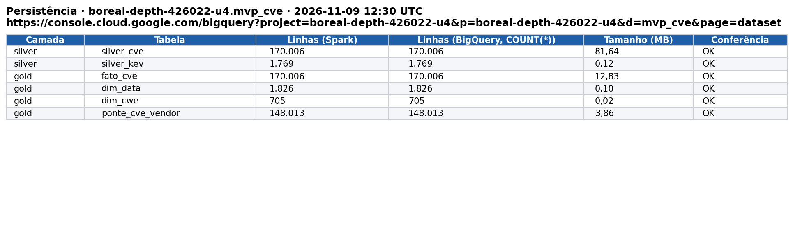
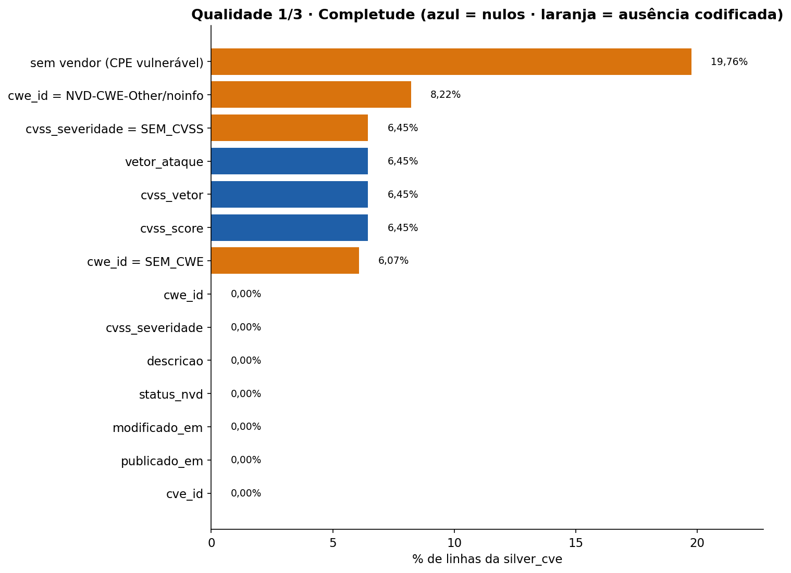
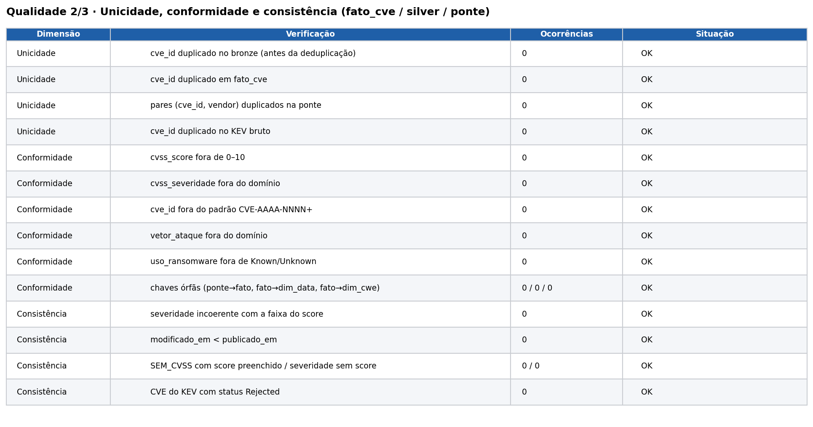
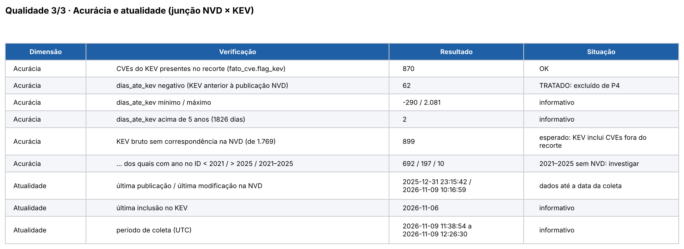
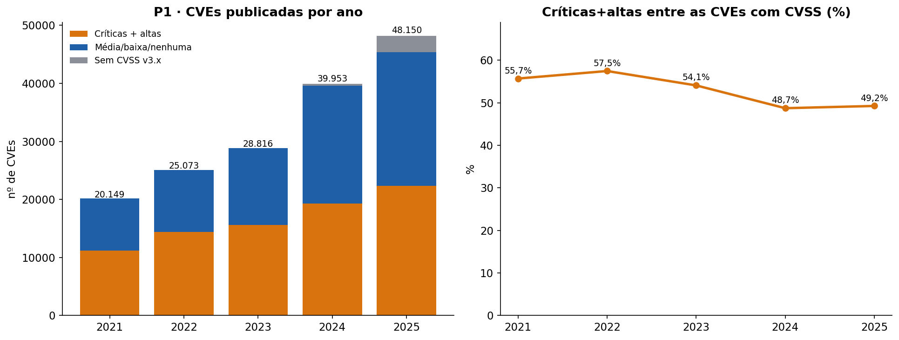
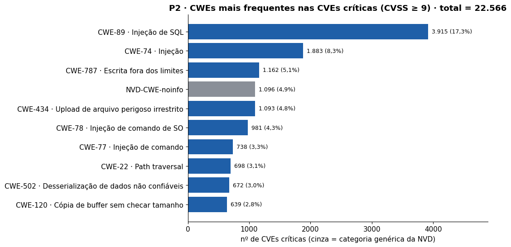
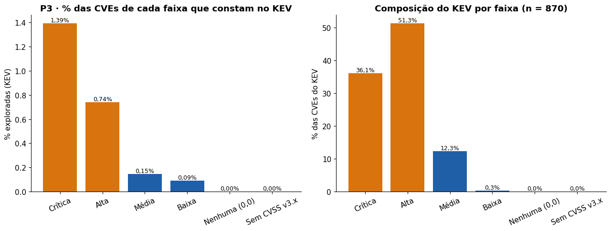
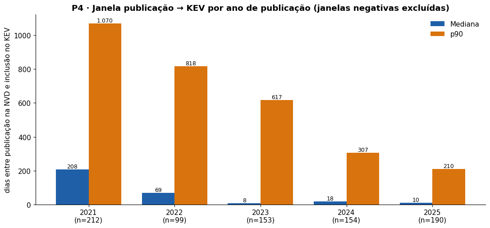
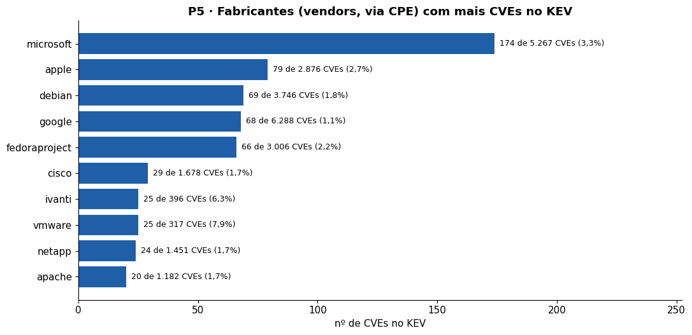

# MVP — O CVSS é um bom critério para priorizar a correção de vulnerabilidades?

**Pipeline de dados em nuvem (Google Colab + PySpark + BigQuery Sandbox) com NVD + CISA KEV**
Universidade de Brasília · Departamento de Engenharia de Produção · Prof. André Luiz Marques Serrano
Aluno: Daniel de Carvalho Vianna (matrícula 231013322) · Trabalho individual

---

## 1. Objetivo

### 1.1 Problema
Equipes de TI recebem milhares de novas vulnerabilidades (CVEs) por ano e têm capacidade de correção limitada: é um problema clássico de **alocação de recursos escassos sob risco**, central na Engenharia de Produção. A prática mais comum é priorizar pela severidade CVSS (críticas e altas primeiro). Este MVP testa se essa regra é eficiente, comparando a severidade publicada na NVD com a **exploração real** das vulnerabilidades, medida pelo catálogo KEV (Known Exploited Vulnerabilities) da CISA.

**Recorte:** CVEs publicadas de 01/01/2021 a 31/12/2025. O KEV só existe desde novembro de 2021; por isso o período de análise de P1 e P4 foi fixado em 2021–2025.

### 1.2 Hipótese
> Priorizar apenas por CVSS gera um backlog grande e pouco eficiente: a maioria das CVEs críticas/altas nunca é explorada e uma parcela relevante das exploradas fica fora da faixa crítica/alta.

A hipótese é refutável: se a taxa de exploração crescer fortemente com a severidade e as faixas crítica/alta cobrirem quase todo o KEV, o CVSS é um bom priorizador.

**Critério de veredito (definido antes da execução):** C1 = precisão das faixas crítica+alta (% dessas CVEs que constam no KEV) < 10%; C2 = cobertura (% do KEV contido nas faixas crítica+alta) < 90%. Confirmada se C1 e C2; parcialmente confirmada se só um; refutada se nenhum. Os limiares são escolha do autor.

### 1.3 Perguntas de negócio
| # | Pergunta | Decisão que apoia |
|---|---|---|
| P1 | Como evoluiu, de 2021 a 2025, o volume anual de CVEs e a participação de críticas/altas? | Dimensionar a carga de trabalho de correção |
| P2 | Quais CWEs (tipos de falha) concentram as CVEs críticas (CVSS ≥ 9)? | Direcionar treinamento e revisão de código |
| P3 | Que fração das CVEs de cada faixa de severidade consta no KEV, e que parcela do KEV é coberta por críticas/altas? | Avaliar a eficiência de priorizar só por CVSS |
| P4 | Qual a janela (mediana, p90) entre a publicação da CVE e sua inclusão no KEV, por ano? | Definir prazos (SLA) de correção |
| P5 | Quais fabricantes (vendors) concentram CVEs exploradas? | Priorizar inventário e monitoramento de ativos |

> Se alguma pergunta não for plenamente respondida, ela permanece nesta lista e é discutida na autoavaliação (seção 8). O período de P1 (originalmente 2016 até o último ano completo) foi ajustado para 2021–2025 pelo motivo do recorte acima.

## 2. Plataforma e arquitetura

- **Plataforma:** Google Colab (execução) + **BigQuery Sandbox** (persistência na nuvem; gratuito, sem cartão). Custo de operação: zero (Colab gratuito, API pública da NVD sem chave, BigQuery Sandbox). No Sandbox as tabelas expiram por padrão em 60 dias; as evidências em PNG deste repositório registram o estado da carga.
- **Arquitetura medalhão:** raw (arquivos JSON/CSV no disco do Colab) → bronze (tabelas Spark, dado como veio) → silver (limpo/tipado, regras de negócio) → gold (modelo estrela). **Silver e gold são gravadas no BigQuery**.
- **Linguagens:** Python (coleta e ETL com PySpark local, versão 3.5.3, modo ANSI ligado) e SQL (qualidade e análise).
- **Execução:** um único notebook, [`MVP_CVSS_KEV.ipynb`](MVP_CVSS_KEV.ipynb), executável com "Executar tudo".

## 3. Dados

| Fonte | Conteúdo | Licença / termos | Formato original |
|---|---|---|---|
| [NVD API 2.0](https://nvd.nist.gov/developers/vulnerabilities) (NIST) | CVEs: datas, CVSS, CWE, configurações afetadas (CPE) | Dados do governo dos EUA, de uso público; [termos de uso da API](https://nvd.nist.gov/developers/terms-of-use) | JSON paginado (500 CVEs/página, janelas de 120 dias) |
| [CISA KEV](https://www.cisa.gov/known-exploited-vulnerabilities-catalog) | CVEs com exploração confirmada, data de inclusão, uso em ransomware | Dados públicos do governo dos EUA | CSV |

- **Data da coleta:** 2026-11-09 11:38:54 a 2026-11-09 12:26:30 (UTC); registro completo em `coleta_meta.json`.
- **Volume obtido:** NVD: 170.006 CVEs em 348 arquivos JSON (838,5 MB), em 16 janelas de até 120 dias, sem chave de API (pausa de 6.5 s entre requisições). O total anunciado pela API (170.006) foi conferido, janela a janela, com o total gravado: coincidem em todas as janelas. KEV: 1.769 linhas (1.093,0 KB).
- **Dados pessoais (LGPD):** a base não contém dados pessoais (apenas identificadores de vulnerabilidades e metadados técnicos). **Dados corporativos:** nenhum.
- Os dados brutos **não** são versionados no GitHub (volume); o notebook reproduz a obtenção.

## 4. Modelagem

Modelo **estrela** na camada gold (grão da fato: uma CVE):
`fato_cve` · `dim_data` · `dim_cwe` · `ponte_cve_vendor` (N:N). Diagrama, **Catálogo de Dados completo (domínios, obrigatoriedade e linhagem)** em [`catalogo_dados.md`](catalogo_dados.md).

## 5. Carga (ETL)

O notebook [`MVP_CVSS_KEV.ipynb`](MVP_CVSS_KEV.ipynb) executa, em ordem:

| Células | Função |
|---|---|
| 1–3 | Configuração, autenticação Google (única ação humana), projeto/dataset no BigQuery, dependências |
| 4 | Coleta: NVD em janelas de 120 dias (retry com backoff, retomada, auditoria) e KEV |
| 5 | Spark local e camada **bronze** |
| 6 | Camada **silver** (limpeza, tipagem, regras de negócio) |
| 7 | Camada **gold** (modelo estrela) |
| 8 | Carga **silver + gold no BigQuery** e conferência de contagens |
| 10 | Qualidade (6 dimensões) |
| 11–12 | Análise P1–P5, gráficos e evidência de persistência |
| 13–15 | Geração automática de README, catálogo, paper (.tex) e .zip |

**Regras de negócio aplicadas na transformação**
1. CVSS: métrica v3.1; se ausente, v3.0; se ausente, `SEM_CVSS`. Dentro de cada versão, usa-se a entrada `Primary` (NVD) quando existe; senão, a primeira listada (pode ser de uma CNA). CVSS v4.0 não é utilizado.
2. Descrição: apenas em inglês.
3. CWE: primeiro CWE listado; ausência vira `SEM_CWE`.
4. Vendors: extraídos do CPE 2.3 (4º segmento, minúsculo) **apenas das correspondências marcadas como vulneráveis** (`vulnerable = true`), para não contar plataformas onde o produto apenas executa; uma CVE pode ter vários vendors (tabela ponte).
5. Junção NVD ↔ KEV pela chave `cve_id` (maiúsculas, sem espaços), com *left join* a partir da NVD.
6. Deduplicação: uma linha por `cve_id`, mantendo a de maior `lastModified` (KEV: mantém a primeira inclusão).
7. `dias_ate_kev` = data de inclusão no KEV − data de publicação na NVD; valores negativos são mantidos na gold e excluídos de P4.
8. CVEs com status `Rejected` são excluídas das análises.
9. Recorte: CVEs com data de publicação de 01/01/2021 a 31/12/2025.

**Persistência na nuvem:** projeto/dataset `boreal-depth-426022-u4.mvp_cve`; console: https://console.cloud.google.com/bigquery?project=boreal-depth-426022-u4&p=boreal-depth-426022-u4&d=mvp_cve&page=dataset. Evidência: 

## 6. Qualidade dos dados

Executada na célula 10 do notebook (completude, unicidade, conformidade, consistência, acurácia, atualidade).

| Dimensão | Verificação | Resultado | Tratamento |
|---|---|---|---|
| Completude | % de nulos por atributo (silver_cve) e ausências codificadas | Nulos relevantes: cvss_score/vetor 6,5%; SEM_CVSS 6,5%; CWE genérico/ausente 14,3%; sem vendor 19,8% | CVSS ausente → SEM_CVSS (mantida, fora de P2); CWE ausente → SEM_CWE; vendor ausente fica fora de P5 (cobertura medida) |
| Unicidade | `cve_id` duplicado (bronze, fato, ponte, KEV) | bronze: 0; fato: 0; ponte: 0; KEV: 0 | Deduplicação na silver (maior `lastModified`; KEV: 1ª inclusão) |
| Conformidade | score 0–10, severidade, padrão do ID, vetor, ransomware, chaves órfãs | fora do domínio: score 0, severidade 0, ID 0, vetor 0, ransomware 0; órfãs 0 | Nenhum tratamento necessário |
| Consistência | severidade × faixa do score; modificação ≥ publicação | severidade incoerente: 0; modificado antes de publicado: 0; KEV com status Rejected: 0 | CVEs `Rejected` excluídas de todas as análises |
| Acurácia | `dias_ate_kev` negativo; KEV sem correspondência na NVD | negativos: 62 de 870 (mín. -290, máx. 2.081); KEV sem NVD no recorte: 899 (692 com ano no ID < 2021; 197 com ano no ID > 2025; 10 com ano no ID de 2021 a 2025) | Janelas negativas excluídas de P4 (reportadas); KEV anterior ao recorte é esperado e não entra na análise |
| Atualidade | última publicação/modificação/inclusão no KEV | publicação 2025-12-31 23:15:42; modificação 2026-11-09 10:16:59; KEV 2026-11-06 | — |

Evidências:   

## 7. Resultados e discussão

Base de análise: 162.141 CVEs publicadas de 01/01/2021 a 31/12/2025 (excluídas 7.865 com status `Rejected`).

### P1 — Evolução anual


| Ano | CVEs | Críticas+altas | % crít./altas (c/ CVSS) | Sem CVSS v3.x | % sem CVSS |
|---|---|---|---|---|---|
| 2021 | 20.149 | 11.220 | 55,7% | 0 | 0,0% |
| 2022 | 25.073 | 14.398 | 57,5% | 12 | 0,0% |
| 2023 | 28.816 | 15.580 | 54,1% | 1 | 0,0% |
| 2024 | 39.953 | 19.307 | 48,7% | 324 | 0,8% |
| 2025 | 48.150 | 22.349 | 49,2% | 2.765 | 5,7% |

**Resultado e discussão:** O volume anual de CVEs (excluídas as 7.865 rejeitadas) foi de 20.149 em 2021 e de 48.150 em 2025, uma alta de 139,0%; o maior volume ocorreu em 2025 (48.150 CVEs). Entre as CVEs que possuem CVSS v3.x, as críticas e altas representaram 55,7% em 2021 e 49,2% em 2025, 52,1% no conjunto do período — parcela expressiva (40% ou mais). No total, a fila prioritária por CVSS (críticas + altas) soma 82.854 CVEs em 5 anos (média de 16.571 por ano, ou cerca de 45,4 por dia).

### P2 — CWEs das CVEs críticas


| CWE | Nome | Críticas | % das críticas |
|---|---|---|---|
| CWE-89 | Injeção de SQL | 3.915 | 17,3% |
| CWE-74 | Injeção | 1.883 | 8,3% |
| CWE-787 | Escrita fora dos limites | 1.162 | 5,1% |
| NVD-CWE-noinfo | — | 1.096 | 4,9% |
| CWE-434 | Upload de arquivo perigoso irrestrito | 1.093 | 4,8% |
| CWE-78 | Injeção de comando de SO | 981 | 4,3% |
| CWE-77 | Injeção de comando | 738 | 3,3% |
| CWE-22 | Path traversal | 698 | 3,1% |
| CWE-502 | Desserialização de dados não confiáveis | 672 | 3,0% |
| CWE-120 | Cópia de buffer sem checar tamanho | 639 | 2,8% |
| CWE-94 | Injeção de código | 622 | 2,8% |
| CWE-287 | Autenticação imprópria | 480 | 2,1% |
| CWE-121 | Buffer overflow na pilha | 441 | 2,0% |
| CWE-119 | Limites de buffer em memória | 396 | 1,8% |
| CWE-20 | Validação de entrada imprópria | 368 | 1,6% |

**Resultado e discussão:** Há 22.566 CVEs críticas (CVSS ≥ 9) no período. As três CWEs específicas mais frequentes entre elas são: CWE-89 (Injeção de SQL) com 3.915 CVEs (17,3%); CWE-74 (Injeção) com 1.883 CVEs (8,3%); CWE-787 (Escrita fora dos limites) com 1.162 CVEs (5,1%). As cinco principais CWEs específicas concentram 40,0% das críticas. Outras 1.456 CVEs críticas (6,5%) estão classificadas em categorias genéricas da NVD (NVD-CWE-Other/noinfo) ou sem CWE, o que limita a orientação de treinamento por tipo de falha.

### P3 — Exploração por faixa de severidade


| Faixa | CVEs | No KEV | % exploradas | % do KEV |
|---|---|---|---|---|
| Crítica | 22.566 | 314 | 1,39% | 36,1% |
| Alta | 60.288 | 446 | 0,74% | 51,3% |
| Média | 72.901 | 107 | 0,15% | 12,3% |
| Baixa | 3.282 | 3 | 0,09% | 0,3% |
| Nenhuma (0,0) | 2 | 0 | 0,00% | 0,0% |
| Sem CVSS v3.x | 3.102 | 0 | 0,00% | 0,0% |

**Resultado e discussão:** Das 162.141 CVEs do recorte, 870 constam no KEV (0,54%). A taxa de exploração por faixa foi: crítica 1,39% (314 de 22.566), alta 0,74% (446 de 60.288), média 0,15% (107 de 72.901), baixa 0,09% (3 de 3.282) e sem CVSS v3.x 0,00% (0 de 3.102). A taxa decresce da faixa crítica para a baixa. A taxa das críticas é 9,5 vezes a das médias. Priorizar críticas e altas implica corrigir 82.854 CVEs para alcançar 760 exploradas: precisão de 0,92% (aproximadamente 109 CVEs críticas/altas corrigidas para cada uma que consta no KEV; 1,7 vez a taxa média do universo). Quanto à cobertura, as faixas crítica e alta contêm 760 das 870 CVEs do KEV (87,4%); 110 CVEs exploradas (12,6%) ficam fora da fila crítica/alta, das quais 0 não têm CVSS v3.x.

### P4 — Janela publicação → KEV


| Ano | CVEs no KEV (n) | Mediana (dias) | p90 (dias) | % em até 30 dias | Excluídas (<0) |
|---|---|---|---|---|---|
| 2021 | 212 | 208 | 1.070 | 7,1% | 3 |
| 2022 | 99 | 69 | 818 | 36,4% | 32 |
| 2023 | 153 | 8 | 617 | 61,4% | 13 |
| 2024 | 154 | 18 | 307 | 57,1% | 7 |
| 2025 | 190 | 10 | 210 | 62,6% | 7 |

**Resultado e discussão:** Considerando 808 CVEs do KEV com janela não negativa, a mediana entre a publicação na NVD e a inclusão no KEV foi de 49 dias e o p90 de 569 dias; 43,6% entraram no KEV em até 30 dias. Por ano de publicação, a mediana foi de 208 dias em 2021 e 10 em 2025. Foram excluídas 62 CVEs com janela negativa (incluídas no KEV antes de publicadas na NVD). A cauda é longa (p90 acima de um ano): parte relevante das CVEs só é reconhecida como explorada muito depois da publicação, de modo que um prazo (SLA) curto e único não captura esses casos e o monitoramento do KEV precisa ser contínuo. Cautela: há censura à direita — CVEs publicadas em anos mais recentes tiveram menos tempo de observação até a data da coleta (2026-11-09), o que tende a reduzir mediana e p90 desses anos.

### P5 — Vendors com mais CVEs exploradas


| Vendor (CPE) | CVEs | No KEV | % no KEV |
|---|---|---|---|
| microsoft | 5.267 | 174 | 3,30% |
| apple | 2.876 | 79 | 2,75% |
| debian | 3.746 | 69 | 1,84% |
| google | 6.288 | 68 | 1,08% |
| fedoraproject | 3.006 | 66 | 2,20% |
| cisco | 1.678 | 29 | 1,73% |
| ivanti | 396 | 25 | 6,31% |
| vmware | 317 | 25 | 7,89% |
| netapp | 1.451 | 24 | 1,65% |
| apache | 1.182 | 20 | 1,69% |
| oracle | 2.382 | 20 | 0,84% |
| linux | 9.489 | 19 | 0,20% |
| fortinet | 789 | 16 | 2,03% |
| sonicwall | 126 | 16 | 12,70% |
| webkitgtk | 48 | 16 | 33,33% |

**Resultado e discussão:** Pelo vendor extraído do CPE (apenas configurações marcadas como vulneráveis), os fabricantes com mais CVEs no KEV são: microsoft (174); apple (79); debian (69); google (68); fedoraproject (66). Cobertura do mapeamento: 100,0% das 870 CVEs do KEV possuem vendor. Uma CVE pode ter vários vendors (por exemplo, o fabricante do produto e as distribuições que o empacotam, como debian e fedoraproject), logo as contagens por vendor se sobrepõem e não devem ser somadas. Verificação cruzada com o campo vendorProject do próprio KEV: Microsoft (163); Apple (72); Google (53); Cisco (25); Ivanti (25).

### Discussão geral
Critério declarado antes da execução: a hipótese é CONFIRMADA se (C1) a precisão das faixas crítica+alta for inferior a 10% e (C2) a cobertura do KEV por essas faixas for inferior a 90%; PARCIALMENTE CONFIRMADA se apenas um dos dois critérios for atendido; REFUTADA se nenhum for. Resultado: precisão = 0,92% (C1 atendido) e cobertura = 87,4% (C2 atendido). Veredito: hipótese CONFIRMADA. A leitura literal da hipótese (a maioria das críticas/altas nunca é explorada) é satisfeita, pois 99,08% das CVEs críticas/altas não constam no KEV. Implicação: usar apenas o CVSS como critério de priorização gera uma fila grande e de baixo rendimento e, ao mesmo tempo, deixa de fora uma parcela relevante das CVEs efetivamente exploradas. Uma política mais eficiente combina o CVSS com um sinal de exploração: tratar primeiro as CVEs presentes no KEV (e, em extensão futura, com alta probabilidade pelo EPSS) e usar o CVSS para ordenar o restante. Ressalvas: o KEV registra apenas exploração conhecida e relevante para o governo dos EUA (subnotificação), e os critérios numéricos (10% e 90%) são uma escolha do autor, explicitada para que o resultado seja auditável; outros limiares podem alterar o veredito.

## 8. Autoavaliação

1. **Perguntas respondidas / não respondidas e por quê:** P1 — respondida. P2 — respondida. P3 — respondida. P4 — respondida; ressalva: censura à direita nos anos recentes. P5 — respondida.
2. **Limitações dos dados:**
   - O KEV só existe desde 2021 e cobre exploração *conhecida*; CVEs fora do KEV podem ter sido exploradas sem registro (subnotificação). Por isso o recorte começa em 2021.
   - 1,9% das CVEs analisadas (3.102 de 162.141) não têm CVSS v3.x (`SEM_CVSS`), concentradas nas mais recentes (5,7% em 2025) e nas aguardando análise na NVD; na silver, que inclui as 7.865 CVEs rejeitadas, o percentual é 6,5%. CVSS v4.0 não foi considerado.
   - Vendor extraído do CPE: 19,8% das CVEs da silver (inclui as rejeitadas) não têm vendor mapeado (configuração não preenchida); entre as CVEs do KEV a cobertura é de 100% (ver P5).
   - O KEV tem viés de relevância para o governo dos EUA e para produtos amplamente usados.
   - Censura à direita: CVEs publicadas em 2025 tiveram pouco tempo para entrar no KEV até a coleta (2026-11-09), o que afeta P3 e P4.
   - Os limiares do veredito (C1 e C2) são arbitrários, ainda que declarados.
3. **Decisões técnicas que mudaria:** usar BigQuery SQL (ou pandas) diretamente em vez de Spark local, que é desnecessário para este volume; coletar com chave de API da NVD para acelerar a coleta; persistir os dados brutos na nuvem (por exemplo, no Cloud Storage), não apenas as tabelas silver/gold; incluir CVSS v4.0 e a data de publicação da CNA.
4. **Extensões para uso contínuo:** coleta incremental (parâmetro `lastModStartDate` da API), orquestração agendada, inclusão do EPSS (probabilidade de exploração), comparação CVSS × KEV × EPSS, alertas por vendor presente no inventário da organização.

## 9. Como reproduzir
1. Abra https://console.cloud.google.com/bigquery com a conta Google que será usada e aceite o modo Sandbox (cria o projeto gratuito).
2. Abra o notebook [`MVP_CVSS_KEV.ipynb`](MVP_CVSS_KEV.ipynb) no [Google Colab](https://colab.research.google.com) (Arquivo → Fazer upload de notebook).
3. Execute **Ambiente de execução → Executar tudo** e autorize o acesso à conta Google quando solicitado (única interação).
4. Aguarde (cerca de 1 hora, limitada pelo limite de requisições da NVD sem chave). Se o Colab desconectar, execute tudo de novo: a coleta é retomável enquanto o ambiente não for reiniciado.
5. Os arquivos gerados ficam em `saida/` e são baixados ao final (arquivos soltos e `saida.zip`).

## 10. Estrutura do repositório
Repositório com estrutura plana (todos os arquivos na raiz):
```
README.md · LICENSE
MVP_CVSS_KEV.ipynb           (pipeline completo: coleta, ETL, BigQuery, qualidade, análise, geração de documentos)
catalogo_dados.md    (catálogo de dados + diagrama + linhagem)
coleta_meta.json     (data, volume e formato da coleta)
short_paper.tex      (artigo curto para o Overleaf; usa p1.png … p5.png)
persistencia.png · qualidade_1_*.png · qualidade_2_*.png · qualidade_3_*.png · p1.png … p5.png   (evidências)
```
