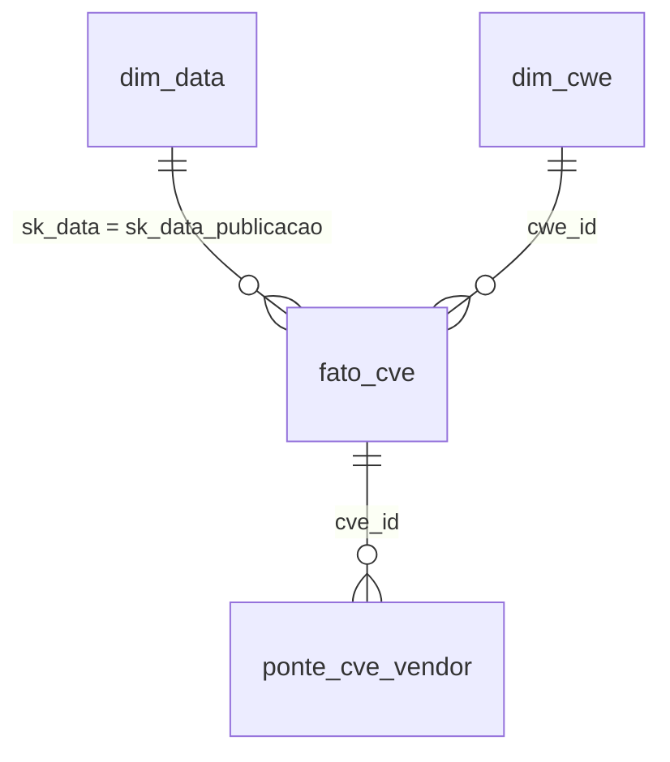

# Catálogo de Dados

Plataforma: Google Colab (PySpark) → **BigQuery Sandbox** (`boreal-depth-426022-u4.mvp_cve`). Modelo: **estrela** na camada gold. Recorte: CVEs publicadas de 01/01/2021 a 31/12/2025.
Colunas "observado" foram calculadas pelo notebook sobre os dados reais carregados.

## Diagrama do modelo



```
dim_data (sk_data PK) ──┐
                        ├── fato_cve (cve_id PK) ──── dim_cwe (cwe_id PK)
                        │         │
                        │         └── ponte_cve_vendor (cve_id, vendor)  [N:N]
```

## Linhagem geral

| Origem | Como foi obtida | Raw | Bronze | Silver | Gold |
|---|---|---|---|---|---|
| NVD (NIST) API 2.0 | Notebook `MVP_CVSS_KEV.ipynb`, célula 4: JSON em janelas de 120 dias por data de publicação, 500 CVEs/página, sem chave | `raw/nvd/*.json` | `bronze_nvd` | `silver_cve`, `silver_cve_vendor` | `fato_cve`, `dim_cwe`, `ponte_cve_vendor` |
| CISA KEV | Mesmo notebook (CSV) | `raw/kev/kev.csv` | `bronze_kev` | `silver_kev` | colunas `flag_kev`, `kev_incluido_em`, `dias_ate_kev`, `uso_ransomware` em `fato_cve` |
| Calendário | Gerado por SQL (`sequence`) entre 2021-01-01 e 2025-12-31 | — | — | — | `dim_data` |

Data da coleta: **2026-11-09 11:38:54 a 2026-11-09 12:26:30 UTC** · NVD: 170.006 CVEs, 838,5 MB · KEV: 1.769 linhas.
Tabelas no BigQuery: `silver_cve`, `silver_kev`, `fato_cve`, `dim_data`, `dim_cwe`, `ponte_cve_vendor`.

## fato_cve (grão: uma CVE) — 170.006 linhas

| Atributo | Tipo | Descrição | Domínio esperado | Domínio observado | Nulos? | Linhagem |
|---|---|---|---|---|---|---|
| cve_id | texto | Identificador da CVE | padrão `CVE-AAAA-NNNN+` | 170.006 distintos | Não | NVD `cve.id`, maiúsculas/trim |
| sk_data_publicacao | inteiro | Chave para `dim_data` (yyyyMMdd) | 20210101 a 20251231 | 20210101 a 20251231 | Não | NVD `published` → data |
| cvss_score | numérico | Nota base CVSS | 0,0 a 10,0 | 0,0 a 10,0 | Sim: sem CVSS v3.x (6,45% na silver) | NVD métrica v3.1; senão v3.0 |
| cvss_severidade | categórico | Faixa de severidade | LOW, MEDIUM, HIGH, CRITICAL, NONE, SEM_CVSS | CRITICAL, HIGH, LOW, MEDIUM, NONE, SEM_CVSS | Não (nulo vira SEM_CVSS) | NVD `baseSeverity` |
| vetor_ataque | categórico | Vetor de ataque CVSS | NETWORK, ADJACENT_NETWORK, LOCAL, PHYSICAL | nulo, ADJACENT_NETWORK, LOCAL, NETWORK, PHYSICAL | Sim (6,45%) | NVD `attackVector` |
| cwe_id | texto | Primeiro CWE associado | `CWE-n`, `NVD-CWE-Other`, `NVD-CWE-noinfo`, SEM_CWE | 705 valores distintos | Não | NVD `weaknesses` |
| status_nvd | categórico | Estado do registro na NVD | Analyzed, Modified, Awaiting Analysis, Undergoing Analysis, Rejected, Deferred… | Analyzed, Awaiting Analysis, Deferred, Modified, Rejected, Undergoing Analysis | Não | NVD `vulnStatus` |
| flag_kev | booleano | CVE consta no KEV | true/false | 870 verdadeiros | Não | junção por `cve_id` |
| kev_incluido_em | data | Data de inclusão no KEV | desde 2021-11 | 2021-11-03 a 2026-11-04 | Sim: nulo = fora do KEV | KEV `dateAdded` |
| dias_ate_kev | inteiro | KEV − publicação, em dias | pode ser negativo | -290 a 2081 | Sim: nulo = fora do KEV | calculado |
| uso_ransomware | categórico | Uso conhecido em campanhas de ransomware | Known, Unknown | nulo, Known, Unknown | Sim: nulo = fora do KEV | KEV `knownRansomwareCampaignUse` |
| modificado_em | timestamp | Última modificação na NVD | ≥ publicação | 2023-11-07 a 2026-11-09 | Não | NVD `lastModified` |

## dim_data

| Atributo | Tipo | Descrição | Domínio |
|---|---|---|---|
| sk_data | inteiro | Chave (yyyyMMdd) | 20210101 – 20251231 |
| data | data | Data completa | 2021-01-01 a 2025-12-31 |
| ano / trimestre / mes | inteiro | Componentes | 2021–2025 / 1–4 / 1–12 |
| dia_semana | texto | Nome do dia | domingo, segunda-feira, …, sábado |

## dim_cwe — 705 linhas

| Atributo | Tipo | Descrição | Domínio |
|---|---|---|---|
| cwe_id | texto | Identificador do CWE | ver `fato_cve.cwe_id` |
| nome | texto | Nome curto (tradução do autor, apenas CWEs mais comuns; nulo nos demais) | texto |
| tipo | categórico | Classificação | CWE específico, Categoria especial NVD, Sem informação |

## ponte_cve_vendor (muitos-para-muitos) — 148.013 linhas, 15.833 vendors distintos

| Atributo | Tipo | Descrição | Domínio | Linhagem |
|---|---|---|---|---|
| cve_id | texto | CVE | idem fato | NVD |
| vendor | texto | Fabricante (4º segmento do CPE 2.3), apenas correspondências vulneráveis | texto minúsculo, sem `*`/`-` | NVD `configurations…cpeMatch.criteria` |

## silver_cve — 170.006 linhas
Atributos de `fato_cve` que vêm da NVD, mais: `publicado_em` (timestamp, NVD `published`), `descricao` (texto em inglês, NVD `descriptions`), `cvss_vetor` (texto, NVD `vectorString`). Nulos observados (%): cve_id 0,00%, publicado_em 0,00%, modificado_em 0,00%, status_nvd 0,00%, descricao 0,00%, cvss_score 6,45%, cvss_severidade 0,00%, cvss_vetor 6,45%, vetor_ataque 6,45%, cwe_id 0,00%.

## silver_kev — 1.769 linhas
`cve_id` (maiúsculas), `vendor_kev` (KEV `vendorProject`), `produto_kev` (KEV `product`), `kev_incluido_em` (KEV `dateAdded`), `kev_prazo` (KEV `dueDate`), `uso_ransomware` (KEV `knownRansomwareCampaignUse`). Contém também CVEs anteriores a 2021, que não entram na `fato_cve`.
